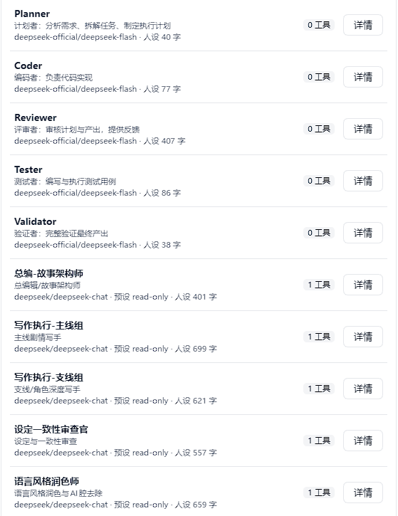
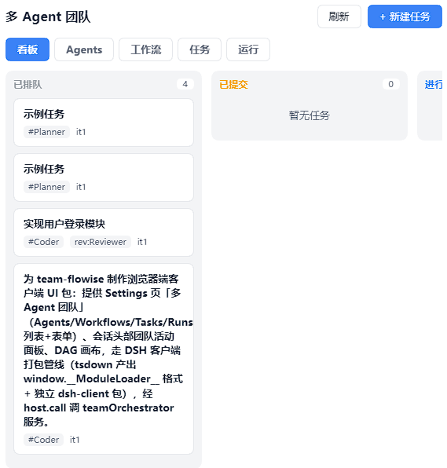

# team-flowise

English | [中文](README.zh.md)

A multi-agent team plugin for [DeepSeek Harness](https://github.com/deepseek-ai/deepseek-harness). Define roles, wire them into a node graph, run it — and watch it work.

One agent is fine until the job has parts. Then you want a planner, a coder, a reviewer, and someone to check the numbers. This gives you those, runs them in dependency order, lets a reviewer send work back, and shows you which step is stuck.

- **Roles are records.** Name, persona, model route, tool preset, timeout. Create them in Settings, or from a conversation with `team_create_agent`.
- **The graph decides the order.** Nodes declare `dependsOn`; everything that is ready runs in the same wave, in parallel.
- **Review is a gate, not a suggestion.** A node can name its own reviewer. Blocking findings go back to the worker verbatim, and rework is bounded — two rounds per node, three per run.
- **Runs stick around.** Roles, workflows, the task ledger and run history live in four durable storage domains. A run cut off by a crash comes back marked interrupted rather than quietly repainted as finished.
- **You can watch it.** The right sidebar carries the graph, each role's progress, and — for the node you select — the model, reasoning effort, output cap and persona it actually ran with, plus the reviewer's verdict.

Seven `team_*` tools drive all of it from the chat: `team_create_agent`, `team_create_workflow`, `team_create_task`, `team_run_workflow`, `team_delegate_agent`, `team_list_agents`, `team_task_status`.

## Screenshots

**Roles.** Every stored role, with the model route it will run under.



**Task board.** Each node of a run becomes one ledger task, so the board *is* the run's state. `it1` means first attempt.



**Run progress.** The graph and its waves, each role's progress, and what the selected node actually ran with. The run below is this plugin building its own UI.


## Install

You need DeepSeek Harness, and a profile that composes a web app — `web` is the usual one.

```sh
dsh plugin --profile web add "git+https://github.com/Drkoh-wz/team-craft.git#path:packages/team-flowise"
```

There is no build step, and nothing to approve.

Verified end to end on **DSH Desktop `0.2.0-rc.2`** and the **`dsh` CLI `0.2.0-rc.2`**, on Node 24. The peer ranges in `packages/team-flowise/package.json` say `>=0.2.0-rc.2 <0.3.0-0`, and the harness checks that declaration before it imports the plugin — so a harness that is too old refuses this plugin in one clear line instead of failing in a confusing way later.

Two things worth knowing, because each of them broke this plugin once.

The harness supplies the `@deepseek-ai/*` packages itself, and a copy sitting in the plugin's own directory is found *first*. A leftover `dsh-tools@0.1.x` from an old local install therefore shadowed the harness's copy, crashed on import, and took the whole Desktop bootstrap down with it. That is also why the floor is `0.2.0-rc.2`: the supply arrived in the 0.2 line, and on `0.1.5` a peers-only plugin cannot import at all. Installing from a checkout? Make sure `packages/team-flowise/node_modules` holds no `@deepseek-ai/*` — `npm install --omit=peer` in that directory is the command that keeps it right.

Install into a profile that has a web app, so you actually get the UI. (The plugin mounts in a bare profile too; you just get no browser half.)

Now restart dsh. Host code and the client bundle are both read at startup, so nothing is live until you do.

<details>
<summary>Installing from a clone instead</summary>

The repository's own installer additionally drops the agent-facing skill into a skill root, and needs no network:

```sh
git clone https://github.com/Drkoh-wz/team-craft.git
cd team-craft
node scripts/install.mjs
```

It is idempotent, it backs up every file it rewrites, and `--help` lists the rest:

```sh
node scripts/install.mjs --check           # exit 0 = installed and consistent, 3 = drifted
node scripts/install.mjs --dry-run         # show the planned changes, write nothing
node scripts/install.mjs --profile <dir>   # a different profile
node scripts/install.mjs --skill-root none # skip the skill
```

</details>

## Did it work?

In this order. Do not trust the browser cache.

| # | Check | Expected |
|---|---|---|
| 1 | `curl -s http://127.0.0.1:3080/api/team-flowise/ping` | `{"ok":true,"pong":true,"domains":[…4…]}` |
| 2 | A new agent session's tool list | the seven `team_*` tools |
| 3 | Settings | a **team-flowise** section: roles, workflows, runs |
| 4 | Right sidebar | a **多 Agent 进度** tab |

A 404 on 1 means it is not mounted — the host log says why, and a duplicate `flowise-team` row is the usual answer. If 1 works but 2 or 3 does not, it mounted and contributed nothing; the log will say that too.

## Uninstall

```sh
dsh plugin --profile web remove @local/team-flowise
```

Or, from a clone, `node scripts/uninstall.mjs` — which also takes the skill back out with `--remove-skill`, and leaves everything it did not write alone.

Restart dsh afterwards, for the same reason as before.

## How it works

| | |
|---|---|
| **Host half** — `packages/team-flowise/src/index.js` | Registers the `team_*` tools, publishes the `teamOrchestrator` service, owns the four storage domains, serves `/api/team-flowise/*`. |
| **Client half** — `packages/team-flowise/src/client/index.js` | The Settings section, the sidebar entry, the progress page. |
| **Skill** — `skills/team-flowise/SKILL.md` | Tells an agent when this is worth reaching for. |

A node is dispatched as a worker subagent carrying the persona, model route and tool preset its role declares. When it reports back, the node's reviewer is asked for a verdict, and blocking findings become the next round's feedback. A reviewer that cannot produce a readable verdict is recorded as an error — and an error never counts as a pass.

## Repo layout

| Path | What it is |
|---|---|
| `packages/team-flowise/` | The plugin: host half, client half, its patch layer |
| `skills/team-flowise/` | The skill |
| `scripts/install.mjs`, `scripts/uninstall.mjs` | The clone-path installer and its inverse |
| `deploy/` | How the plugin is wired into a profile, plus a portable profile snapshot |
| `specializations/leasing-risk/` | A ready-made ten-role team for lessee repayment-risk assessment |
| `validation/` | The test suites |

## Contributing

- The host half is plain ESM JavaScript. The client half uses `React.createElement` and has to keep the `window.__ModuleLoader__.load({ id, factory })` shape. Neither half may add a runtime dependency.
- `deploy/web-profile/package.json` is a portable template — its dependency path is relative to itself. Do not hand-edit a live profile; run the installer.
- `node validation/preflight-install.mjs` is the release gate: it installs the package every published way into throwaway profiles, then boots one and drives its whole HTTP surface. It needs network access and starts a temporary host on a free port.

## License

MIT — see [LICENSE](LICENSE).
