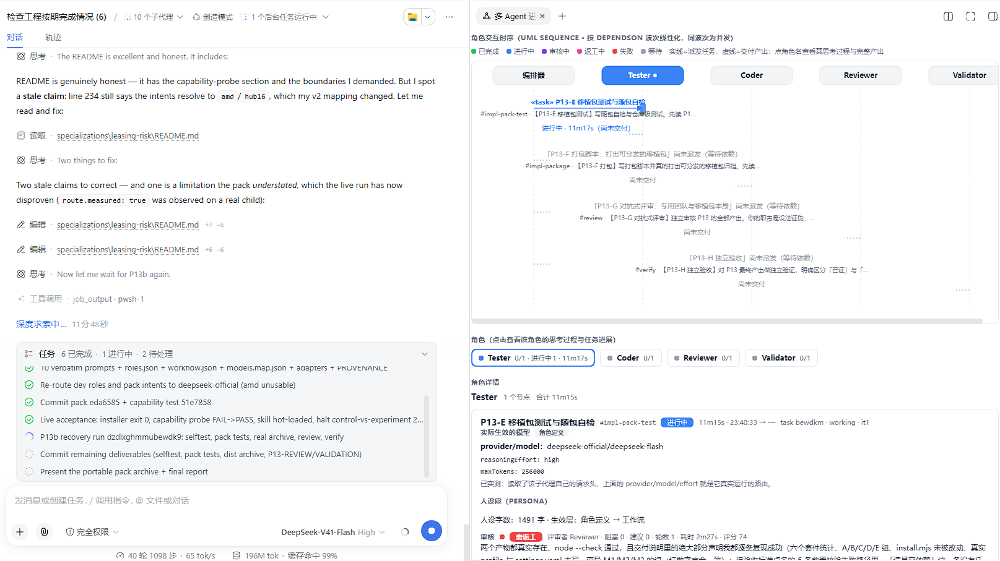

# team-flowise — a multi-agent team orchestration plugin for dsh

English | [中文](README.zh.md)

`@local/team-flowise` turns "one agent does everything" into "a team of roles
does it and leaves evidence": a dependency-ordered node graph, per-role model
routes / personas / tool presets / timeouts, an independent review gate with
bounded rework, a durable run ledger, and a progress panel in the web UI.

- host half: `packages/team-flowise/src/index.js` — registers the `team_*` model
  tools, publishes the `teamOrchestrator` service, owns four storage domains,
  serves `/api/team-flowise/*`
- client half: `packages/team-flowise/src/client/index.js` — settings section,
  sidebar entry, right-pane progress page
- skill: `skills/team-flowise/SKILL.md` — tells an agent when and how to use it
- wiring snapshot: `deploy/` — how the plugin is mounted into a dsh profile

## Screenshots

**Roles.** The Agents tab lists every stored role with the model route it will
run under and a one-line summary of its persona. A role created here is a plain
record; the run reads it when a node names it.


**Task board.** Every node of a run becomes one ledger task, so the board is the
run's own state — columns are lifecycle, and a card carries its assignee and its
iteration count. `it1` means first attempt; a card that was sent back says so.


**Run progress.** The right sidebar carries the live run: the node graph with its
wave-by-wave dispatch, each role's own progress, and — for the node you select —
what it actually ran with: provider and model, reasoning effort, output cap, the
persona it got, and the reviewer's verdict. The run below is this plugin
building its own UI.



---

## Install

### From GitHub, as a dsh plugin (the official route)

The plugin is a plain package inside this repository, so dsh's own plugin command
can install it straight from GitHub — no clone, no registry:

```sh
dsh plugin --profile web add "git+https://github.com/Drkoh-wz/team-craft.git#path:packages/team-flowise"
```

That command is a thin pnpm forwarder: it installs the package into the profile's
`node_modules`, adds it to `dsh.profile.bundles`, and composes the layer. Because
`packages/team-flowise/package.json` declares `dsh.bundle.patch`, the bundle is
recognised as a profile layer, and because that bundle's own `cordis.patch.yml`
declares the `flowise-team` row, **installing the package is enough to mount it**.

Two details that are load-bearing rather than incidental:

- the `#path:packages/team-flowise` fragment is required. This repository has no
  root `package.json` (it is a multi-package repo: the plugin, a client package,
  specializations, skills, validation tooling), so an install aimed at the repo
  root resolves to nothing usable. pnpm's `#path:` fragment is what selects the
  subdirectory — verified against a bare git remote before this line was written.
- there is no `prepare` script, so nothing needs building on install and pnpm does
  not have to be granted a build approval.

Restart dsh afterwards; then verify with the table under
[Verify after the restart](#verify-after-the-restart).

### From a clone

Everything below covers the local-clone path, which additionally installs the
agent-facing skill and works with no network access.

### Prerequisites

| Requirement | Why | How to check |
|---|---|---|
| Node.js ≥ 20 (built-in modules only, no npm install needed) | `scripts/install.mjs` / `uninstall.mjs` use `node:` builtins exclusively | `node --version` |
| A dsh profile directory (`package.json` + `cordis.yml` / `cordis.patch.yml`) | that is where the plugin row and the dependency live | `node scripts/install.mjs --check` |
| The plugin package checked out locally | it is mounted as a local `file:`/`link:` dependency, never published to a registry | `ls packages/team-flowise/package.json` |
| dsh itself installed and its profile able to resolve `@deepseek-ai/*` bundles | the profile already depends on them | you are running dsh |

A profile is recognized by **both**: a `package.json` and a `cordis.yml` (or
`cordis.patch.yml`). Anything else is rejected with a clear error, so the script
cannot be pointed at the wrong directory by accident. The default target is
`<dsh-home>/profiles/web` — `<dsh-home>` is `$DSH_HOME` when set, otherwise
`~/.dsh` (`%USERPROFILE%\.dsh` on Windows).

### One command

From the repository root:

```sh
node scripts/install.mjs
```

That is the whole install. It is **idempotent**: run it again and it reports
`已存在，跳过` for every step and writes nothing. Useful variants:

```sh
node scripts/install.mjs --help                  # all options
node scripts/install.mjs --profile <dir>         # install into another profile
node scripts/install.mjs --dry-run               # print the planned changes + line diff, write nothing
node scripts/install.mjs --check                 # verify only: exit 0 = installed & consistent, exit 3 = drifted
node scripts/install.mjs --json                  # machine-readable report on stdout
node scripts/install.mjs --dep-spec relative     # force "file:<relative>" instead of the "auto" choice
node scripts/install.mjs --skill-root none       # do not install the skill
```

What it does, in order:

1. **validates** the target profile (and that `--package` really is
   `@local/team-flowise`);
2. creates `<profile>/node_modules/@local/team-flowise` →
   `<repo>/packages/team-flowise`. On Windows this is a **directory junction**,
   so no administrator rights and no Developer Mode are required. An existing
   link that points somewhere else is a **hard error**, never a silent
   overwrite (`--force` is the explicit way to replace it). If linking is
   refused, the script fails with the remediation instead of quietly copying —
   a copy would stop tracking source edits;
3. adds `"@local/team-flowise"` to `<profile>/package.json` `dependencies` and to
   `dsh.profile.bundles` (deduplicated; existing order is never re-shuffled).
   The dependency value defaults to `file:<relative>` when the profile and the
   package are on the same drive, otherwise `file:<absolute>`. An existing value
   that already resolves to this package is left **untouched** — so a live
   profile's hand-written `link:...` is preserved;
4. **retires** a legacy `- insert:` row for `flowise-team` from
   `<profile>/cordis.patch.yml`. The row is declared by the bundle that owns it
   (`packages/team-flowise/cordis.patch.yml`), which is what makes installing the
   package sufficient; a second copy in the profile would compose the same id
   twice and dsh would fail at boot (`duplicate loader entry id`). A profile
   wired by an older version of this repository still has one, so the script
   removes it — never adding one. Every other line, comment included, is kept
   byte-identical, and the file is left a valid top-level YAML array (`[]`);
5. copies the skill into `<dsh-home>/skills` (override with
   `--skill-root agents|project|none` or `--skill-dir <dir>`), validating its
   frontmatter first;
6. prints what a restart is needed for, and how to verify afterwards.

Every file it rewrites is first backed up to `<file>.bak-<timestamp>` (the backup
is skipped when a backup of that same second already exists, so an older backup
is never destroyed). `--dry-run` writes nothing at all.

### Why a restart is required

Host code and the client bundle are both loaded, or snapshotted, **at startup**:

- the profile composition (bundles + `cordis.patch.yml` + `--patch` overlays) is
  parsed and mounted when the host boots, which is when `packages/team-flowise/src/index.js`
  is imported and the `flowise-team` row is instantiated. A new row cannot appear
  in a running host;
- the client half is read from the `dsh.client` bundle once, at activation, and
  the host then serves that snapshot immutably. Source edits reach the browser
  only through an HMR `rebuilt()` push, which needs a running build watcher (the
  dsh implementation checkout provides one via `pnpm run dev:web`). Without a
  watcher, **a client change also needs a restart**.

So: stop dsh, start it again. Edits to the two source files behave the same way.

There is one exception, and it is worth knowing because it bites during exactly
the migration `scripts/install.mjs` performs: the profile's own patch file
(`cordis.patch.yml`) is **watched while the host is running**. `dsh` reads
`dsh.profile.patchReload` from the profile manifest and defaults it to `live`
when it is absent. Removing a row from that file therefore does not wait for a
restart — the host re-composes immediately, and the plugin is unmounted on the
spot (observed: `/api/team-flowise/*` turning 401 and the `team_*` tools
disappearing from the tool list, minutes before any restart).

That cuts both ways. It means removing the legacy profile-level row takes effect
at once and leaves the plugin unmounted until the next restart boots the bundle's
own patch — so **do the migration and the restart in the same sitting**, as the
verification table below assumes. And it is the same mechanism the plugin market
uses for its hot disable/enable toggle: writing `- id: …` + `disabled:` into that
file is a live-changeable switch, no restart involved.

### Verify after the restart

Do not trust the browser cache or the old process — check, in this order:

| # | Check | Expected |
|---|---|---|
| 1 | `node scripts/install.mjs --check` | exit 0, every step `已存在，跳过` |
| 2 | Host HTTP: `GET http://127.0.0.1:3080/api/team-flowise/ping` | `{"ok":true,"pong":true,"domains":[...4 domains...]}` — a 404 means the row did not mount |
| 3 | **Tools**: open a new agent session and look at its tool list | 7 tools, each with its own description: `team_create_task`, `team_task_status`, `team_create_agent`, `team_create_workflow`, `team_list_agents`, `team_delegate_agent`, `team_run_workflow` |
| 4 | **UI**: dsh Web GUI → Settings | a `team-flowise` section (roles / workflows / runs) |
| 5 | **UI**: right sidebar | a "多 Agent 进度" (multi-agent progress) tab |
| 6 | The skill | `node -e "console.log(require('fs').existsSync(require('path').join(require('os').homedir(),'.dsh','skills','team-flowise','SKILL.md')))"` → `true`, and the skill list of a new session contains `team-flowise` |

If 2 fails, the row is not mounted: re-run `--check`, then read the host log for
the boot error (a duplicate `flowise-team` row id, or a link that points at a
directory without `src/index.js`, are the two common causes). If 2 passes but 3
or 4 fails, the plugin mounted but contributed nothing — check the host log for
the row's own warnings.

### Uninstall

```sh
node scripts/uninstall.mjs            # default target: <dsh-home>/profiles/web
node scripts/uninstall.mjs --check    # exit 0 = nothing left installed, exit 3 = leftovers
node scripts/uninstall.mjs --remove-skill   # also unmount the skill (default: keep it)
```

It removes exactly what the installer added — the link, the `dependencies` entry,
the `dsh.profile.bundles` entry, and any legacy `- insert:` block — and is
idempotent too (a second run reports `不存在，跳过` for everything). Comments and
all other lines of `cordis.patch.yml` stay byte-identical; if the patch layer is
left with no entries at all, the script re-adds a `[]` line, because dsh requires
that file to be a top-level YAML array (a comments-only file would make the host
throw at boot). Backups (`*.bak-<timestamp>`) are always kept. The skill is kept
by default: it is a user-level asset; `--remove-skill` moves it **out** of the
skill root (into `<dsh-home>/.team-flowise-removed-<timestamp>/`), so it cannot
be discovered any more but can still be restored by hand.

Restart dsh afterwards — for the same reason as above.

---

## Layout

| Path | What it is |
|---|---|
| `packages/team-flowise/` | the plugin package (host half, client half, `cordis.patch.yml`) |
| `scripts/install.mjs`, `scripts/uninstall.mjs` | the portable installer / uninstaller described above |
| `skills/team-flowise/SKILL.md` | the skill installed into a skill root |
| `deploy/` | how the plugin is wired into a dsh profile, plus a portable profile snapshot |
| `validation/` | the acceptance scripts (`p8`, `p10`, `p11`, `p12`, `p13`, `p15`, `p16`) |
| `workflows/` | example workflow definitions |
| `images/` | the screenshots above |

## Notes for contributors

- The host half is ESM plain JavaScript (`src/index.js`); the client half uses
  `React.createElement` and must keep the
  `window.__ModuleLoader__.load({ id, factory })` structure. Neither half may
  add external dependencies.
- `deploy/web-profile/package.json` is a **portable template**: its
  `file:../../packages/team-flowise` is relative to `deploy/web-profile/`
  itself. Do not edit a live profile by hand — run `scripts/install.mjs`.
- Anything a client-plugin change requires (rebuild/refresh) is documented in
  `deploy/README.md`.
- `packages/team-flowise-client/` is the P5 standalone client prototype. It is
  **not** mounted by any profile — the shipped client half is
  `packages/team-flowise/src/client/index.js`. A few scripts under `validation/`
  import its build output, which is why it is still here.
- The `P*.md` files at the repository root are the contemporaneous plan / review /
  validation records of each development phase, kept verbatim. They describe the
  code as it was at that phase, so they are history, not current documentation —
  where they disagree with the code or with this README, the code wins. In
  particular, several of them state that a bundle patch layer cannot add a new
  row; that was wrong, and `deploy/README.md` records the measurement that
  disproved it.

## Publishing this plugin

The community catalog is
[`awesome-dsh-plugin`](https://github.com/awesome-dsh-plugin/awesome-dsh-plugin),
which the dsh-market plugin reads. What an entry needs:

| Requirement | Where it stands |
|---|---|
| a `dsh.bundle` manifest in `package.json` | `packages/team-flowise/package.json` |
| a `cordis.patch.yml` next to it | `packages/team-flowise/cordis.patch.yml` |
| root **or** a `packages/` / `plugins/` / `apps/` subpackage | this is a `packages/` subpackage |
| `@deepseek-ai/*` declared as `peerDependencies` | the ones the host provides; the two this package imports are `dependencies` instead, with the measurement below |
| the `dsh-plugin` topic on the repository | repository setting, not a file |
| a repository at least one day old | waits itself out |
| a description that is accurate, no marketing | README first paragraph |

An entry for a monorepo subpackage points at the subdirectory and names the
subpackage — see the registry's `contributing.md`. This repository also ships the
plugin-market-compatible path fragment in the install command above.

### Which official packages go where

The registry advises declaring official `@deepseek-ai/*` packages as
`peerDependencies`. That advice assumes the host makes them resolvable, and with
a stock profile it does not: dsh's profile template sets
`nodeLinker: hoisted` **and `autoInstallPeers: false`**, so a peer is never
installed. A plugin that *statically imports* such a package therefore fails at
`import` time on a clean machine — measured, not assumed:

```text
fresh `dsh plugin add`, stock profile:
  @deepseek-ai/dsh-tools         -> MODULE_NOT_FOUND
  @deepseek-ai/dsh-storage-domain-> MODULE_NOT_FOUND
  zod                            -> resolved
```

The package that a bundle imports at runtime therefore goes in `dependencies`;
only what the host genuinely provides stays a peer. That is the same split other
listed host-plane plugins use (`dsh-heartbeat` keeps the package it imports in
`dependencies`). With that split, on a stock profile:

```text
  @deepseek-ai/dsh-tools         -> <profile>/node_modules/@deepseek-ai/dsh-tools/lib/index.js
  @deepseek-ai/dsh-storage-domain-> <profile>/node_modules/@deepseek-ai/dsh-storage-domain/lib/index.js
```

The remaining `peerDependencies` are the host bundles whose Cordis services this
plugin `inject`s; they are intentionally not installed, and pnpm reports them as
unmet peers on every host-plane plugin. That warning is expected.

### Screenshots in the storefront

dsh-market shows AppStore-style screenshots, and a repository declares them with
a `screenshots.json` **next to the package's `package.json`** — for a monorepo
entry that means inside the subdirectory, and the paths may not contain `..`. The
images here live at the repository root (`images/`), which is outside
`packages/team-flowise/`, so this repository declares nothing and the storefront
falls back to extracting images from this README. To curate the order instead,
move the images under `packages/team-flowise/` and add the file there.

### Release tarball (optional)

Storefronts prefer a prebuilt tarball over a source build. The repository's own
`scripts/pack-plugin.mjs` emits an *installer* archive (package + skill +
installer), which is a different artefact; the tarball a package manager consumes
comes from `npm pack`:

```sh
npm pack ./packages/team-flowise --pack-destination dist
# rename to a version-free asset name, because `releases/latest/download/<name>`
# resolves `latest` at request time but takes the filename literally
mv dist/local-team-flowise-0.1.0.tgz dist/team-flowise.tgz
```

Attach `dist/team-flowise.tgz` to a GitHub Release named after the version, and
point the catalog entry at it.

### Catalog entry

The submission is one file added to `awesome-dsh-plugin/awesome-dsh-plugin`,
named `data/plugins/Drkoh-wz__team-craft--packages-team-flowise.yml`:

```yaml
url: https://github.com/Drkoh-wz/team-craft/tree/main/packages/team-flowise
name: Drkoh-wz/team-craft#team-flowise
category: workflow
tarball: https://github.com/Drkoh-wz/team-craft/releases/latest/download/team-flowise.tgz
description:
  en: 'Dependency-ordered multi-agent team runner for DeepSeek Harness: define roles, run a node graph with an independent review gate and bounded rework, and watch progress in the web UI.'
  zh: 'DSH 的多角色团队编排插件：定义角色、按依赖跑节点图，带独立评审与有上限的返工，并在界面里看进度。'
```

A description is read as a claim about the code and is checked against it, so it
names only what exists. `category` is the maintainers' call — `workflow` is the
closest fit and being off by one is fixed on their side, not grounds for
rejection.

## License

MIT — see [`LICENSE`](LICENSE).
